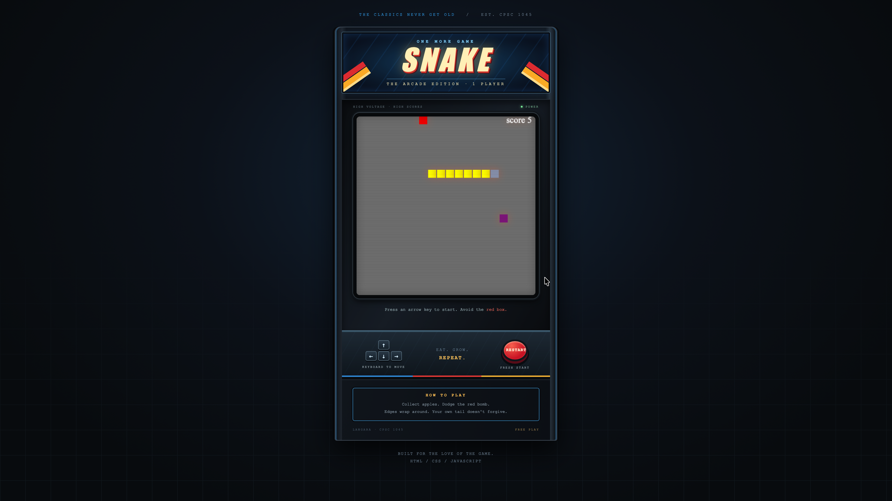
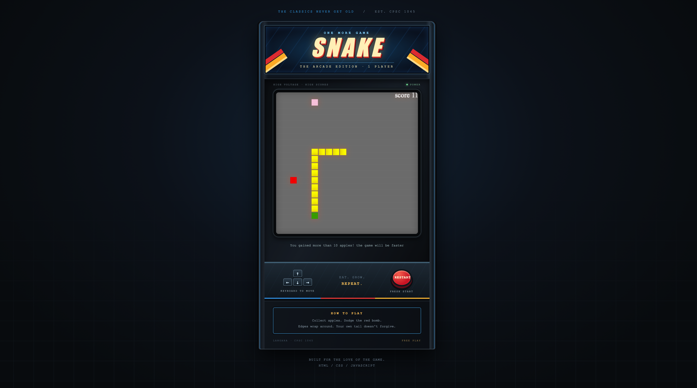
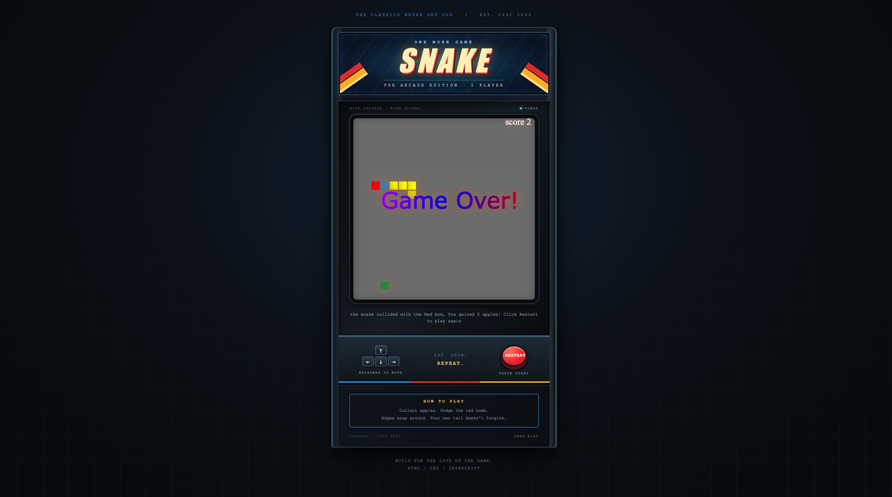
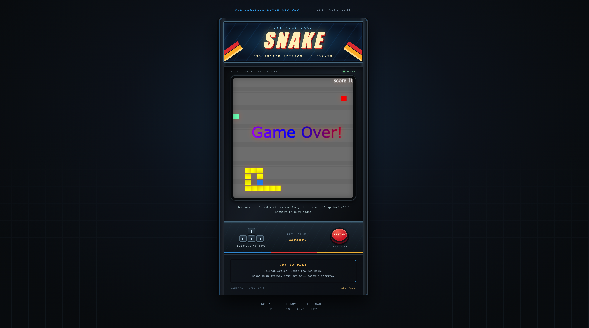

# 🐍 Snake — The Arcade Edition

**Eat. Grow. Repeat. Try not to become your own worst enemy.**

A classic Snake game built for **CPSC 1045 — Introduction to Web Programming at Langara College**, now dressed up as a retro arcade cabinet. Collect colorful apples, dodge the red bomb, and see how long you can survive as the pace picks up.

Built with **HTML, CSS, vanilla JavaScript, and the Canvas API**. One player. No dependencies. No quarters required.



*Five apples in. Plenty of room. Surely nothing can go wrong.*

## 🕹️ Step up to the cabinet

1. Clone or download this repository.
2. Keep `snake.HTML`, `snake.css`, and `snake.JS` together in the same folder.
3. Open **`snake.HTML`** in a desktop browser.
4. Press an arrow key to start your run.

That's it—no installation or build step.

Prefer a local server? With Python 3 installed, run this from the project folder:

```sh
python3 -m http.server 8000
```

Then visit [localhost:8000/snake.HTML](http://localhost:8000/snake.HTML). Preserve the filenames' capitalization, including the uppercase `.HTML` and `.JS` extensions.

## The rules are simple. Staying alive is the tricky part.

| Control | What it does |
| --- | --- |
| ↑ / ↓ / ← / → | Steer the snake with your keyboard |
| **Restart** | Reload the page for a fresh run and a score of zero |

- **Chase the changing colors.** The apple is the square that changes color, just like the snake's head. Each apple adds one point and one body segment.
- **Respect the red box.** The bomb starts on the board and jumps to a random position whenever you eat an apple. Touch it and your run ends.
- **Take the scenic route.** Crossing an edge wraps you to the opposite side of the board.
- **Watch your tail.** Hitting your own body ends the game. Immediate direction reversals are blocked.
- **Read your result.** The message beneath the screen explains what ended the run and how many apples you collected.

## 🍎 More apples, less breathing room

Your reward for doing well? A longer snake and less time to think.

| Apples collected | Target updates per second | The mood |
| --- | --- | --- |
| 0–10 | 6 | Getting comfortable |
| 11–20 | 9 | Okay, pay attention |
| 21–30 | 14 | Those turns come quickly |
| 31+ | 21 | One more apple… |

The project report describes milestones of 10, 20, and 30 apples. The code checks **greater than** each milestone, so the speed increases at **11, 21, and 31**.



*Eleven apples: the first speed boost kicks in. Your tail is now a planning problem.*

## 💥 Two ways to meet the Game Over screen

### The red box wins



*Two apples, one unfortunate turn. The red box is definitely not a snack.*

### Your own tail wins



*Ten apples later, the biggest obstacle is you. Luckily, Restart is right there.*

## From course project to arcade cabinet

The game began with a YouTube tutorial and programming examples from course slides and labs. The [complete project report](docs/project-report.pdf) describes the gameplay enhancements: wrapping boundaries, custom colors and styling, a relocating bomb, a restart button, increasing speed, and feedback messages.

The later arcade presentation adds a glowing **SNAKE** marquee, blue cabinet trim, a recessed screen with subtle scanlines, a red arcade-style restart button, and printed instructions. The cabinet is drawn with CSS, and this presentation update preserves the JavaScript game logic.

## Under the hood

```text
snake-game/
├── README.md                  # You're here
├── snake.HTML                 # Cabinet structure, canvas, and controls
├── snake.css                  # Cabinet artwork, lighting, and responsive layout
├── snake.JS                   # Movement, rendering, scoring, and collisions
├── docs/
│   └── project-report.pdf     # Complete course project report and references
└── screenshots/
    ├── game-in-progress.png   # A run at 5 apples
    ├── higher-difficulty.png  # First speed increase at 11 apples
    ├── bomb-collision.png     # Game over from the red bomb
    └── body-collision.png     # Game over from the snake's own body
```

The game draws on a **400 × 400 canvas**. A `setTimeout` loop updates the snake's position, checks collisions, and redraws the board. An array stores body segments, keyboard events control direction, and restarting reloads the page. The HTML, CSS, and JavaScript include explanatory comments for following along with the implementation.

### A few quirks of this cabinet

- Play requires a keyboard; there are no touch controls or pause button.
- Scores belong to the current run and are not saved between sessions.
- Random apple and bomb placement does not exclude occupied tiles, so objects can overlap.
- Boundary wrapping includes a coordinate just outside the visible canvas, which can briefly hide the head.

## 📚 Credits and references

The following sources are listed in the [complete project report](docs/project-report.pdf), in its **“References which I used to built this Game”** section:

- **YouTube tutorial — starting point for the game:** [Watch the referenced Snake tutorial](https://www.youtube.com/watch?v=baBq5GAL0_U&t=1211s). This preserves the report's timestamp at 20:11; the report does not supply the video's title or creator name.
- **W3Schools:** [Web development tutorials and references](https://www.w3schools.com/).
- **MDN Web Docs:** [Web platform documentation](https://developer.mozilla.org/en-US/).
- **Tailwind CSS:** [Background-color documentation](https://tailwindcss.com/docs/background-color). Listed as a reference in the report; this project uses plain CSS and does not require Tailwind.
- **CPSC 1045 course materials:** lecture slides and previous lab work. The report credits these examples as the basis for much of the code and its functions.

The report also contains the development description and original user manual. The screenshots above show the current arcade presentation.

---

**One more game? The cabinet is always open.**
